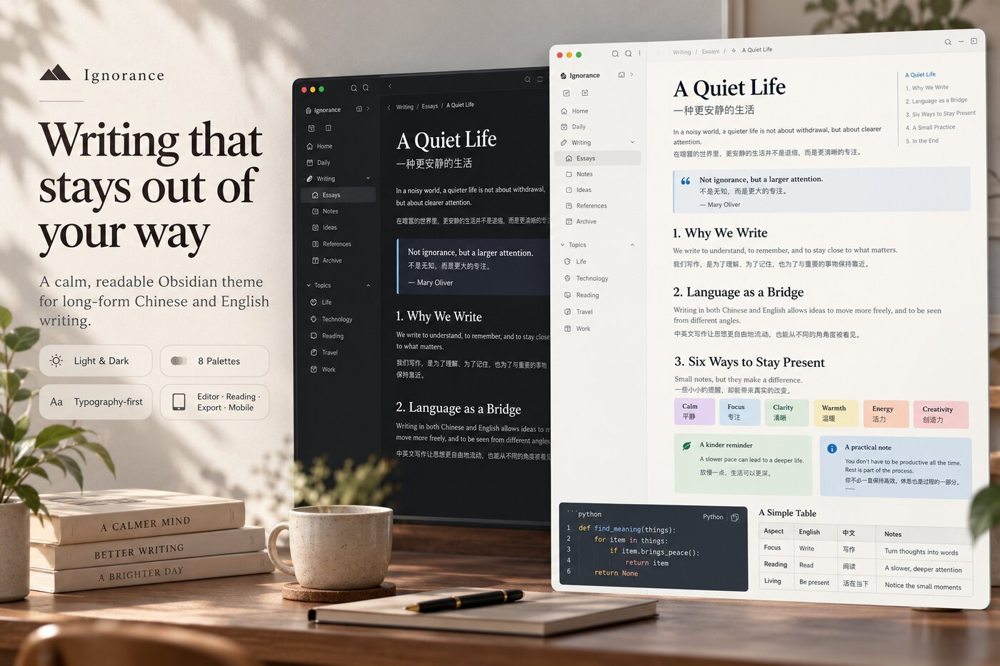
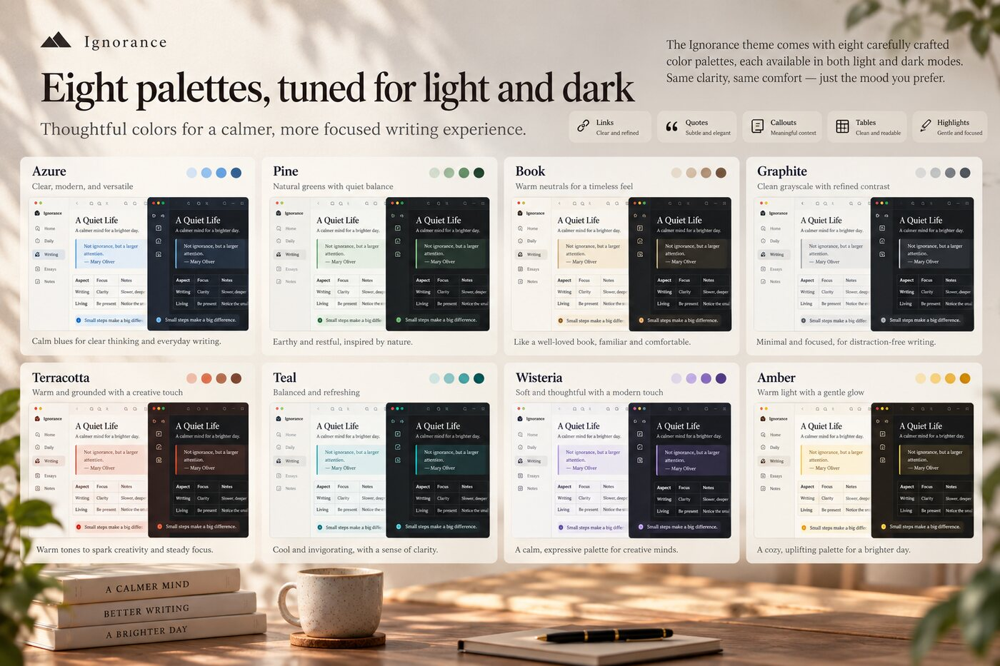
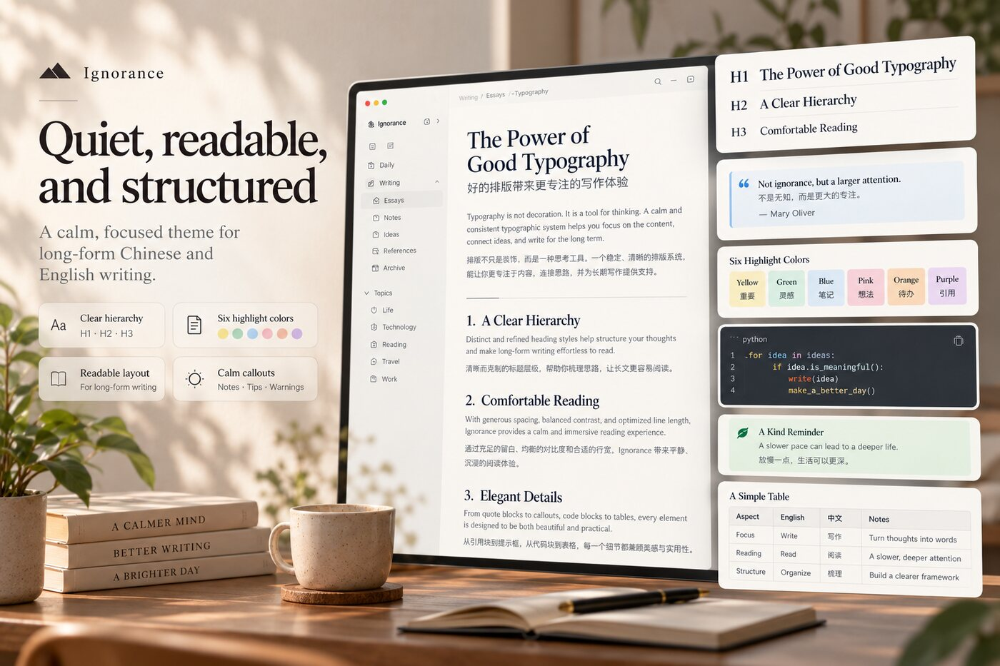
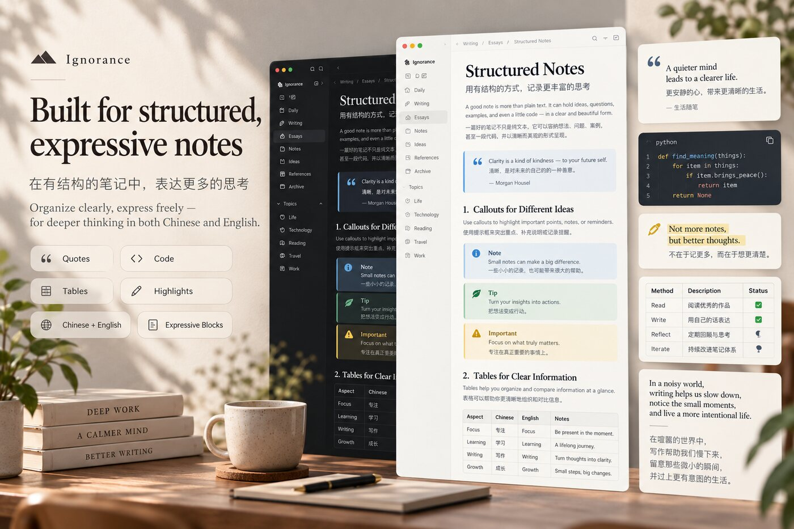
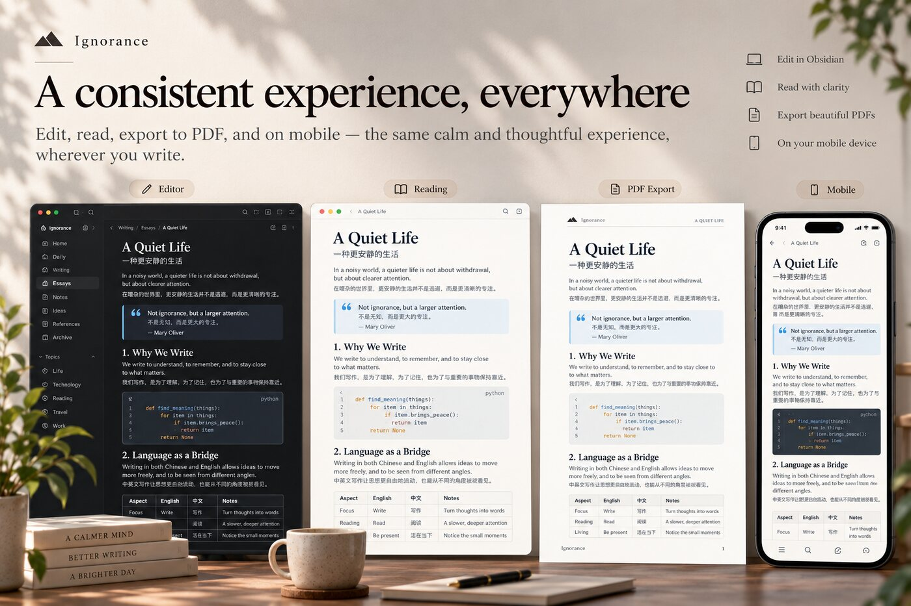
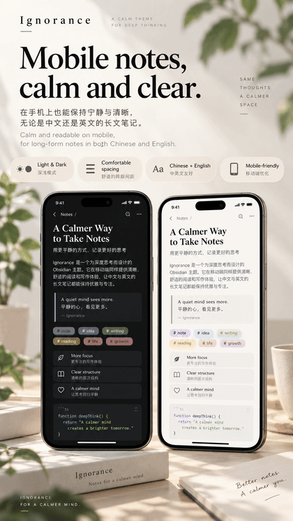

<div align="center">

# Ignorance

**A calm, readable Obsidian theme for long-form Chinese and English writing.**
Eight colour palettes · light and dark · the same care in editing, reading, export and on mobile.

[中文](README.zh-CN.md) · [Companion plugin](https://community.obsidian.md/plugins/ignorance-advanced) · [Support](#support)




</div>

## Colourful, on demand

Pick one of **eight palettes**, each tuned separately for light and dark: Azure, Pine, Book, Graphite, Terracotta, Teal, Wisteria and Amber. Headings, links, quotes, highlights, callouts and tables all follow the palette. Palette switching lives in the companion plugin; the theme itself ships with the Azure default.

<div align="center">

<br><br>
 
</div>

## Quiet, readable, structured

<div align="center">

<br><br>

</div>

## One look, everywhere

<div align="center">



### On your phone



</div>

## What it does

- **Typography first**: system fonts with PingFang SC / Microsoft YaHei, a reading column sized to your window, generous line height, a clear H1–H6 scale that stays identical in Live Preview, Reading view and exports.
- **Considered blocks**: quotes with a bold rail, tables with a stronger header and soft stripes, code blocks with header, line numbers and syntax colours, callouts in several tones, round task checkboxes, footnotes, and six highlight colours that follow Obsidian's `--highlight-background-*` variables.
- **Light and dark designed together**, with calibrated contrast. Obsidian's own accent colour can optionally take over.
- **Mobile**: tighter spacing, horizontally scrolling tables, finger-sized controls.
- **Print and PDF**: sidebars and controls disappear; export matches the screen.
- **Respects your settings**: honours "reduce motion" and your font and size choices.

## Install

**From Obsidian**: Settings → Appearance → Themes → Manage → search "Ignorance" → Install and use. ([theme page](https://community.obsidian.md/themes/ignorance))

**Manually**: download `theme.css` and `manifest.json` from the [latest release](https://github.com/ignorance-shiyao/obsidian-ignorance/releases/latest) into `<vault>/.obsidian/themes/Ignorance/`, then pick *Ignorance* under Settings → Appearance.

## Recommended: the companion plugin

The theme works on its own, though some looks depend on the companion plugin. Add **[Ignorance Advanced](https://community.obsidian.md/plugins/ignorance-advanced)** for the palette switcher, Mermaid and ECharts blocks, table and image tools, paged reading, presentations (PPT view and PPTX export), and exports.

**Theme only:** body text, headings, quotes, callouts, tables, code blocks and the default Azure palette all work in full.

**Needs the plugin:** Mermaid diagram colours, charts and `:::` containers, slides, the reader and paged view, export styling, and a few details the plugin marks up (image alignment from alt text, compact layout for tables with six or more columns, cells holding a single code span, no arrow on links that wrap an image, file-tree icons).

## Notes

- Fonts are not bundled; Noto Sans CJK SC is the fallback.
- Per-note layouts: add `ib-wide`, `ib-narrow`, `ib-compact` or `ib-no-title` to a note's `cssclasses` property. To keep the text column narrow and let only tables or images use more of the pane (Reading view), add `ib-wide-tables` or `ib-wide-images`; on a phone or in a narrow pane they stay at column width.
- Works with the Style Settings plugin: content width and wide-block width, heading font, heading level labels, quote size, wrapping long code lines, table text size and stripes, compact sidebars, and corner radii for code blocks, callouts and tables. With Ignorance Advanced enabled, its own font and heading-label settings take priority.
- Canvas and Graph take their colours from the theme (canvas background, dots and card labels; graph lines, nodes, tags and attachments).
- Third-party plugins that ship their own views may keep their own styling.
- `docs/style-check.md` exercises every element; copy it into a vault to review the theme.

## Development

`src/theme.css` is the readable source; `theme.css` is its minified build.

```bash
npm ci && npm run build                      # regenerate theme.css
scripts/install-to-vault.sh /path/to/vault   # copies theme.css and manifest.json into the vault
```

## Feedback

If you run into a problem or want a feature, please [open an issue](https://github.com/ignorance-shiyao/obsidian-ignorance/issues). A screenshot and your Obsidian version help a lot.

## Support

If you enjoy the theme, you can buy me a coffee. Thank you!

| WeChat | Alipay |
| --- | --- |
|  |  |

## License

[MIT](LICENSE).
